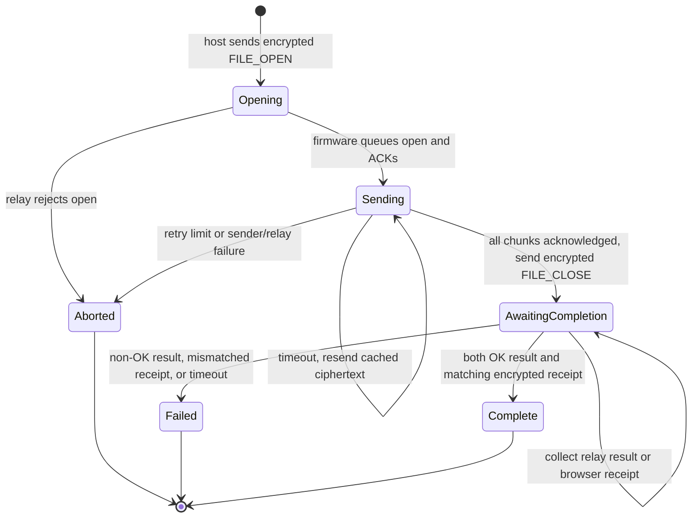

# Protocol reference

This document is the canonical wire-level reference for communication between the native Bluetooth companion, Pico firmware, and host agent. It describes the formats implemented by the current source. When this document and code disagree, treat code as authoritative and update this document in the same change.

Related documents:

- [Architecture](ARCHITECTURE.md)
- [Hardware](HARDWARE.md)
- [Contributor guidance](../AGENTS.md)
- [Python scripting reference](SCRIPTING.md)
- [Threat model](THREAT_MODEL.md)

## Bluetooth control v3

Shared definitions: `crates/ble-protocol`; allocation-free crypto and provisioning:
`crates/ble-session`. V3 deliberately rejects v1/v2 peers and plaintext commands.
One connection, one outstanding logical request/effect, no effect retries.
All integers are little-endian; reserved bytes must be zero.

| UUID (128-bit) | Characteristic | Operation / size |
| --- | --- | --- |
| `7069636f-0001-4c32-9b89-5d7a00000001` | Service | project service |
| suffix `00000002` | Info | public read, 20 bytes |
| suffix `00000003` | Status | public read, 12 bytes |
| suffix `00000004` | Auth | handshake fragment write with response, 9–20 bytes |
| suffix `00000005` | Command | encrypted-record fragment write with response, 9–20 bytes |
| suffix `00000006` | Result | sequential response-fragment reads, fixed 20 bytes |
| suffix `00000007` | Events | encrypted stream notifications, fixed 20 bytes |

Info: bytes 0–3 `PBLE`, byte 4 version `3`, byte 5 mandatory control flag `4`
plus optional overview-v1 flag `8`, USB-identity-v1 flag `16` and stream/filesystem-v1
flag `32` and native-download-v1 flag `64` (current value `124`),
bytes 6–7 zero, bytes 8–19 printable ASCII build label with zero padding.
Status: byte 0 version, byte 1 flags (bit 0 USB enabled, bit 1 USB ready,
bit 2 agent recently present), bytes 2–3 zero, bytes 4–11 uptime seconds `u64`.
These public diagnostics are not authenticated and do not grant authority.

### Handshake and records

A unique random 32-byte PSK and 16-byte device ID are installed before deployment.
Use exactly `Noise_NNpsk0_25519_ChaChaPoly_SHA256`, with empty handshake payloads.
Prologue is the 16 ASCII bytes `pico-control-v3:` followed by the device ID.
Each side supplies a fresh X25519 ephemeral for every handshake. Each of the two
handshake messages is exactly 48 bytes. The companion writes the first on Auth
and reads the second through Result. Completing the handshake does not acquire
control: the first NNpsk0 message can be replayed. A valid fresh encrypted record
must follow, and only encrypted Acquire grants the connection's control lease.

Noise Split yields independent client-to-Pico and Pico-to-client keys. Transport
records use ChaCha20-Poly1305 with associated data `[3, 4, seq_lo, seq_hi]`, and
nonce four zero bytes followed by the sequence as little-endian `u64`. Sequences
are independent nonzero `u16` values per direction, strictly increasing, allowing
gaps but no replay. A skipped/incomplete upload cannot consume a nonce again.
Disconnect/reconnect before exhaustion; every new connection has fresh keys.
This is a project record envelope using Noise-derived keys, not Noise's implicit
sequential transport framing. There is no plaintext fallback or OS bond.

| Fragment offset | Field |
| --- | --- |
| 0 | version `3` |
| 1 | outer kind: handshake `3`, encrypted record `4`; Events accepts only encrypted stream `7` |
| 2–3 | nonzero monotonic `u16` token/record sequence |
| 4–5 | `u16` payload offset |
| 6–7 | `u16` complete length, at most 4,142 bytes |
| 8–19 | 1–12 payload bytes |

Writes use exact final-fragment length. Result reads are always 20 bytes with
zero padding after the final fragment's exact payload. Headers are untrusted:
reassembly checks contiguous offsets, consistent token/kind/total, nonzero/newer
tokens and lengths; records additionally authenticate their sequence and all
plaintext. A newer token starting at offset zero abandons an incomplete upload.
Five-second partial-upload expiry prevents resuming abandoned fragments. The
companion uses one token space for its handshake and records. The server's record
sequence is independent of the echoed handshake token.

Result holds one finite response of at most 304 bytes. Handshakes and ordinary
snapshots remain 48 bytes; overview ciphertext uses up to 304. Each ATT read advances its
fragment cursor; reading past the end fails. A new completed authenticated command
or Poll replaces the previous response at offset zero. This permits cancellation
of a partially read response. ATT acknowledgement confirms a fragment, not an
authenticated record, effect admission or HID completion.

Encrypted command plaintext is one inner kind byte plus its payload: control
`1`, script `2`, USB identity `5` when Info advertises flag `16`. Control payload is exactly one opcode: Acquire `0`, Release `1`,
USB on `2`, USB off `3`, Poll `4`, ReadOverview `5` when Info advertises flag `8`.
Except Poll and Acquire, controls require the
lease; Release/USB off require no reserved HID job. USB off acknowledges only
after USB tasks stop, the device pull-up/controller are disabled, and cleanup
finishes; a two-second shutdown timeout reports Busy. Public USB-enabled state
represents intent, whereas USB-ready drops on cleanup. Neither flag is a host
operating-system registry acknowledgement. Script retains the existing
version-1 29-byte envelope, full request/process/effect `u64` IDs, leading kind
byte `8`, and up to 4,096 KBD1 bytes. Maximum plaintext is therefore 4,126 bytes,
plus the 16-byte tag. No USB tag, script version or KBD1 limit changes.

Ordinary encrypted response plaintext is exactly 32 bytes: ResultValue (20) followed by
Status (12). ResultValue: byte 0 version, byte 1 code, bytes 2–3 command token,
bytes 4–19 zero. Codes: idle `0` (token zero only), acquired `1`, released `2`,
admitted `3`, completed `4`, cancelled `5`, rejected `6`, USB unavailable `7`,
busy `8`, USB changed `9`. Poll preserves this result token and terminal state.
The server encrypts a fresh snapshot for every completed command/Poll; the client
polls until a correlated response, timeout or disconnect. Snapshot record sequence
and contained command/result token are different fields.

### Protected event stream and filesystem v1

Info flag `32` negotiates this extension. The companion subscribes to Events before
Acquire, then sends encrypted inner kind `6` FlowStart. No plaintext stream is
accepted on Auth/Command. Notifications use outer kind `7`, the same 8-byte header
and zero-padded 20-byte values, with a 2,071-byte ciphertext maximum. At MTU 23 or
larger, values remain 20 bytes; larger fragments are a separate optimization.

The server-to-client stream uses the same directional Noise key with a **disjoint
nonce domain**: nonce four zero bytes followed by LE `u64((1 << 32) | sequence)`;
associated data `[3, 7, seq_lo, seq_hi]`. Its nonzero increasing `u16` sequence and
replay counter are independent of finite responses. Finite responses can overtake
partial streams. Nonces/counters are never reset by Release/FlowStart; fresh
connections establish fresh keys. Cross-lane authentication and replay are tested.

Flow payloads (inside encrypted kind `6`) are exact:

- Start: `[1, 0]`; enables four fragment credits, only once per acquired lease.
- ACK: `[1, 1, sequence:u16, next_offset:u16, 4]`; grants four credits after exactly
  the current sent batch or final fragment. A repeated latest receipt is an
  idempotent no-op, so priority cancellation may interrupt ACK upload safely.
- Probe: `[1, 2]`; requests one deterministic maximum-size test record while idle.

ACKs are fresh encrypted commands. They do not replace the finite response/HID
result. Notification submission alone never grants credits. Intermediate ACKs
follow contiguous fragment admission; final ACK follows AEAD/envelope validation
into bounded application storage. This is a directory/event receipt, not a disk
save or a USB transfer-chunk ACK. The sender owns one ciphertext, and the relay
owns at most one directory page plus eight best-effort buttons. Four credits leave
ATT request/reply headroom in the unchanged eight-packet pool. Send waits are
bounded at 100 ms. An unfinished stream disconnects after 30 seconds without
GATT activity; command uploads/finite reads may postpone pumping. The client
bounds listing/probe I/O at 30 seconds, and browser requests at 35 seconds.

Stream plaintext is ASCII `PES1`, schema `1`, event kind `u8`, then exact body:

| Event kind | Body |
| --- | --- |
| `1` | unchanged filesystem-v1 page, at most 2,048 bytes; request ID remapped to the companion ID |
| `2` | released button `u8`: A `0`, B `1`, X `2`, Y `3` |
| `3` | 2,048-byte probe: bytes 0–2039 equal index modulo 256; 2040–2041 negotiated ATT MTU; 2042 fragment queue high-water; 2043 button queue high-water; 2044 page queue high-water; 2045–2047 zero |

Filesystem command inner kind `8` requires acquired control and started streaming:
`[1, 0, filesystem-v1 request]` lists; `[1, 1, request_id:u64]` cancels. Requests
use a 512-byte UTF-8 path maximum, 64-entry limit, cursor and hidden flag. Empty
path uses the agent's home. Finite admission responses use ordinary 32-byte
snapshots with the command token and codes `10` accepted, `11` cancelled, `12`
agent unavailable (or existing Busy/Rejected). These direct responses preserve
the independent HID result; Poll cannot retrieve a filesystem admission result.

USB tags 29/30/31 and filesystem version 1 are unchanged. Firmware maps each list
onto USB ID `(connection_incarnation << 32) | command_token`; late host pages,
duplicates, cancelled lists and replacement connections cannot claim its slot.
The adapter strictly validates the full page before queueing/remapping. Native
validation also checks correlation, cursor progress, duplicate names, canonical
path/hidden consistency and the 512-entry accumulation bound. Superseding a list
cancels it before issuing the replacement. Cancellation drains already credited
ciphertext and discards its obsolete ID; it never replays a request after loss.
Menu chords, menu releases, Payloads controls and device-wide Stop releases do
not publish button events. Native button history is bounded at 32 and cleared on
release/disconnect. Generic secure-transfer sinks remain unavailable.

### Protected overview v1

ReadOverview requires an authenticated, acquired connection. Its response is a
finite record and preserves the active effect's ResultValue. It uses the same
directional encryption, sequences, fragmentation and read cursor as snapshots.
This finite operation does not use the notification lane or alter USB TLV. The companion
reads it after acquiring control and targets a ten-second refresh interval while
idle; USB status targets one second. Only one request runs at a time.

| Plaintext offset | Field |
| --- | --- |
| 0–3 | ASCII `POV1` |
| 4 | overview schema version `1` |
| 5 | CDC stage: idle `0`, armed `1`, downloading `2`, verified `3`, failed `4`, cancelled `5` |
| 6 | flags: bit 0 installer packaged/available, bit 1 agent heartbeat seen; others zero |
| 7 | script envelope version |
| 8–9 / 10–11 | USB filesystem / transfer protocol versions, `u16` |
| 12–13 / 14–15 | maximum KBD1 / USB TLV payload bytes, nonzero `u16` |
| 16–23 | age in milliseconds of agent heartbeat, `u64`; zero if never seen |
| 24–27 / 28–31 | maximum single / total device delay milliseconds, `u32` |
| 32–35 | four string byte lengths, `u8`: build, agent version, OS, hostname |
| 36–37 | echoed authenticated ReadOverview command token, nonzero `u16` |
| 38–39 | reserved zero |
| 40 onward | strings in the stated order, printable ASCII, no padding/trailing data |

String bounds are 96/32/24/96 bytes, respectively; build is nonempty, empty agent
fields mean unknown. Plaintext is at most 288 bytes, ciphertext 304, read in at
most 26 default-MTU fragments. The client validates the echoed command token
after authentication. Presence still expires after 25 seconds using the existing
heartbeat; age is sampled at overview time, not a continuously advancing value.
USB protocol versions describe retained agent formats, not implemented native
filesystem/download workflows. Layouts belong to the companion's lowering library;
the device executes language/layout-independent KBD1.

New companions accept earlier v3 Info without the overview flag and omit this
request. Earlier v3 companions require the old exact flag value and will reject
the new firmware; update companion and firmware together. V1/v2, unknown Info
flags, unknown overview versions and malformed metadata remain incompatible;
there is no plaintext or physical-pairing fallback.

Cancel uses a newer encrypted record to abandon an incomplete Run, then targets
its full IDs if already admitted. Run completion retains its Run token; cancelling
an upload not yet admitted returns Cancelled with the Cancel token. The client
accepts either for that scoped Cancel. Disconnect invalidates incarnation-owned
completion delivery and cancels only that connection's remote effect. Local
payloads and physical Y Stop remain independent.

Missing/corrupt provisioning, malformed handshake/record, authentication failure
and sequence exhaustion fail closed. An unauthenticated connection expires 30
seconds after accept, including under continuous GATT traffic; reads/fragments
cannot extend that deadline. Each disconnect imposes a 250-ms advertising delay.
The prototype does not provide strong radio denial-of-service resistance.

### Protected USB identity v1

Inner kind `5` requires authenticated acquired control. Its bounded requests and
responses use the existing encrypted record, directional sequence and read cursor;
they preserve the HID ResultValue. An unacquired request fails closed. Plaintext
requests are schema byte `1`, opcode (Read `0`, Save `1`), followed by an identity
only for Save. Read is exactly two bytes. Save is at most 84 bytes before its
inner kind and 16-byte authentication tag.

Identity is `manufacturer_len:u8`, manufacturer bytes, `product_len:u8`, product
bytes, with exact length and no trailing data. Strings are printable ASCII
(`0x20..0x7e`), manufacturer at most 32 bytes and product at most 48. Empty strings
are valid. These bounds also apply to the flash schema and native editor.

| Response plaintext offset | Field |
| --- | --- |
| 0–3 | ASCII `PCF1` |
| 4 | identity schema version `1` |
| 5 | success `0`, USB active `1`, reserved HID/CDC work `2`, invalid input `3`, flash/readback failure `4` |
| 6–7 | echoed authenticated command token, nonzero `u16` |
| 8 onward | current identity, using the two length-prefixed strings above |

Responses are 10–90 plaintext bytes, at most 106 encrypted bytes and nine
MTU-23 reads; the existing 304-byte response slot is unchanged. The native client
validates correlation after decryption. Read reloads the winning flash record;
no valid record means defaults. Save requires USB disabled **and fully stopped**,
no reserved HID job or active installer, and holds the shared USB lifecycle gate.
It never changes VID/PID/serial or key provisioning. Apply names by enabling USB
again, which rebuilds descriptors. A successful Save means persisted and verified,
not merely staged in RAM. Unchanged valid records incur no erase/program wear.

The native app reads identity after acquiring control. Background refreshes do
not overwrite edits. Rejected saves retain the draft; a flash failure requires
Reload before retry. Timeout/disconnect never automatically replays a save: a
commit may have succeeded even if its acknowledgement was lost.

Earlier v3 firmware without flag `16` remains usable with identity editing disabled.
Older companions that reject new Info flags require updating alongside firmware.
Unknown flags, schema versions, status values, invalid strings and excess data
remain errors; no plaintext downgrade is provided.

### Persistent USB identity record v1

The existing two 4-KiB slots remain at `0x10FFE000..0x11000000`, separate from
control keys and the embedded agent image. Each starts with magic `0x50494346`
(`FCIP` bytes) at 0–3, version `1` at 4, reserved zeros at 5–7, wrapping `u32`
sequence at 8–11, payload length `u16` at 12–13, IEEE CRC32 at 14–17, then the
identity payload at 18 onward. CRC covers the payload only. Firmware selects the
newer valid slot using wrap-aware comparison; equal sequences select the second.
Legacy records load without migration and invalid records fall back to defaults.

Saving erases only the inactive 4-KiB slot, programs a 256-byte staged page with
erased magic, verifies it, then programs the complete page with magic and verifies
both exact bytes and decoding. Until commit, the previous valid slot remains
boot-loadable. An error after commit can leave a complete new record; firmware
attempts to reconcile RAM but reports failure until the companion explicitly reads
again. This operation cannot write the key region or change the memory map.

### Factory provisioning record v1

Dedicated two 4-KiB slots at `0x10BFC000..0x10BFE000`, separate from USB identity
and absent from firmware ELF load segments. Each slot begins with a 64-byte
record: `PKEY` at 0–3, version `1` at 4, zero at 5–7, nonzero `u32` sequence at
8–11, IEEE CRC32 at 12–15, device ID at 16–31 and PSK at 32–63. CRC covers bytes
0–11 and 16–63. Firmware chooses the valid newer sequence using wrap-aware
comparison. All-zero ID/key is invalid; no compiled default exists. The initial
provisioning image writes sequence 1 to slot 0 and leaves the remainder erased.
CRC detects corruption; it is not authentication or encryption at rest. Remote
key rotation is not implemented. See HARDWARE.md for trusted provisioning.

## Scope and conventions

There are two application transports:

1. Bluetooth GATT between the native companion and firmware (version 3 above).
2. A TLV byte stream between firmware and the host agent over the USB control CDC-ACM interface.

Unless stated otherwise:

- Multi-byte integers are unsigned and little-endian.
- Lengths are byte lengths.
- Text is UTF-8.
- Array indices and chunk indices are zero-based.
- Reserved bits must be sent as zero and ignored by receivers unless a protocol version says otherwise.
- `D -> H` means device firmware to host agent; `H -> D` means host agent to device firmware.
- `B -> D` means browser to device; `D -> B` means device to browser.

Types used in layout tables:

| Notation | Meaning |
| --- | --- |
| `u8` | One unsigned byte |
| `u16`, `u32`, `u64` | Little-endian unsigned integer |
| `bytes[n]` | Exactly `n` uninterpreted bytes |
| `utf8[n]` | Exactly `n` bytes of UTF-8 text, without a terminator |
| `rest` | All remaining bytes in the containing frame |

## Legacy USB/bulk version inventory

WebSocket/HELLO entries and browser-specific sections below are historical wire
reference only: the WLAN endpoint and browser have been removed. USB tags and
bulk payload formats remain unchanged; native BLE now relays filesystem v1, while bulk transfers remain unavailable.

## Version inventory

| Surface | Current version | Where carried | Compatibility behavior |
| --- | ---: | --- | --- |
| WebSocket command/event protocol | 2 | `HELLO.protocols.websocket`; response/event `version` fields | The frontend reports a compatibility error when the WebSocket version differs. Version 2 supports encrypted chunk batching; the single firmware transfer pump emits batches when PSRAM is available. |
| `HELLO` schema | 1 | Top-level `HELLO.version` | The frontend requires `event_type = "hello"` and `version = 1`. |
| File-transfer protocol | 2 | `FILE_OPEN.protocol_version`; WebSocket transfer event `version` | There is no plaintext downgrade: the host and frontend reject the v1 file path. |
| Filesystem protocol | 1 | First `u16` in list requests and pages | Host agent and frontend reject unsupported versions; firmware refuses to forward mismatched pages. |
| Keyboard bytecode | `KBD1` | Four-byte bytecode magic | Firmware executor rejects other magic values. This is an internal effect format, not a user language. |
| USB TLV envelope | Unversioned | None | Compatibility is maintained by stable tag numbers and versioned payloads for complex subprotocols. |

Version numbers are independent. A file-transfer or filesystem format change does not automatically require a WebSocket version bump if it is fully capability-gated and backward compatible, but a change to command framing, response correlation, binary-kind routing, or required `HELLO` fields does.

## USB control CDC TLV stream

### Serial and framing

The host opens the USB CDC port as 115200, 8 data bits, no parity, and 1 stop bit. Because CDC-ACM runs over USB, the baud rate is primarily an API setting rather than a physical UART clock.

The byte stream is a sequence of frames:

| Offset | Field | Type | Notes |
| ---: | --- | --- | --- |
| 0 | `tag` | `u8` | Message type from the registry below |
| 1 | `payload_len` | `u32` | Number of payload bytes; maximum 2048 |
| 5 | `payload` | `bytes[payload_len]` | May be empty |

USB packet boundaries have no application meaning. Headers and payloads may be split across USB packets, and multiple frames may be present in a read buffer.

There is no envelope checksum. File-transfer v2 uses ChaCha20-Poly1305 authentication; keyboard bytecode retains its own integrity checks.

Both endpoints reject lengths over 2048 and attempt to resynchronize. The host decoder scans forward for a plausible complete frame; the firmware decoder slides its five-byte header window after an oversized length. A producer must never depend on this recovery behavior.

Implementation:

- Firmware encoder/stream decoder and tag routing: `firmware/src/usb/ctrl.rs`
- Host frame type, encoder, decoder, and resynchronization: `apps/host-agent/src/tlv.rs`
- Host serial reader/writer and control-port probing: `apps/host-agent/src/transport.rs`

### Tag registry

| Tag | Name | Direction | Payload | Status |
| ---: | --- | --- | --- | --- |
| 1 | `EXECUTE` | D -> H | UTF-8 shell command | Active; host executes it and emits tag 9 output. |
| 2 | `DEBUG_MSG` | D -> H | UTF-8 diagnostic text | Active for `handshake-ok`, `probe-ok`, and logs. |
| 3 | `WS_CONNECT` | Legacy/reserved | Unspecified | Recognized by host transport, not handled by current firmware. |
| 4 | `WS_DATA` | Legacy/reserved | Unspecified | Recognized by host transport, not handled by current firmware. |
| 5 | `WS_DISCONNECT` | Legacy/reserved | Unspecified | Recognized by host transport, not handled by current firmware. |
| 6 | `WS_DATA_RECV` | Legacy/reserved | Unspecified | Recognized by host transport, not handled by current firmware. |
| 7 | `REQUEST_AGENT_STATUS` | Bidirectional | Empty, or ASCII `handshake` | Active for discovery, handshake, probes, and keepalive. |
| 8 | `AGENT_STATUS` | H -> D | Versioned agent identity described below | Active. |
| 9 | `EXECUTE_RESULT` | H -> D | Raw output chunk, up to 2048 bytes | Host produces it; current firmware logs it as unhandled. |
| 10 | `MIC_PCM_DATA` | Reserved | Unspecified | Recognized by host transport; no current producer/consumer. |
| 11 | `DB_CREDENTIALS_REQUEST` | D -> H | Optional UTF-8 prompt label | Active. |
| 12 | `DB_CREDENTIALS_RESPONSE` | H -> D | Empty for cancel, otherwise `username + NUL + password` | Active. |
| 20 | `FILE_OPEN` | H -> D | v2 public envelope plus encrypted manifest | Active. |
| 21 | `FILE_CHUNK` | H -> D | v2 public envelope plus AEAD ciphertext | Active. |
| 22 | `FILE_ACK` | D -> H | Contiguous progress and window credit | Active. |
| 23 | `FILE_CLOSE` | H -> D | v2 public envelope plus encrypted totals/hash | Active. |
| 24 | `FILE_RESULT` | D -> H | Terminal result | Active. |
| 25 | `FILE_ABORT` | Bidirectional | Terminal abort reason | Active. |
| 26 | `FILE_HEARTBEAT` | H -> D | Currently ignored | Reserved for transfer liveness; no current sender. |
| 27 | `FILE_START_REQUEST` | D -> H | Legacy plaintext path | Disabled; current host rejects it. |
| 28 | `FILE_SET_DEFAULT_PATH` | D -> H | Legacy plaintext path | Disabled; current host rejects it. |
| 29 | `FS_LIST_REQUEST` | D -> H | Versioned filesystem request | Active. |
| 30 | `FS_LIST_PAGE` | H -> D | Versioned filesystem page | Active. |
| 31 | `FS_LIST_CANCEL` | D -> H | `request_id: u64` | Active. |
| 32 | `TRANSFER_SESSION_TO_HOST` | D -> H | Versioned session negotiation or Noise transport envelope | Active for file transfer only. |
| 33 | `TRANSFER_SESSION_TO_BROWSER` | H -> D | Versioned session negotiation or Noise transport envelope | Active for file transfer only. |
| 34 | `HOST_OS` | H -> D | UTF-8 target OS name, at most 24 bytes in firmware | Active; `macos` is normalized to `mac`. |
| 240 | `USB_BENCHMARK_START` | Test host -> D | Benchmark version, random token, and ACK cadence | Diagnostic; starts a bounded synthetic CDC-ingress measurement. |
| 241 | `USB_BENCHMARK_DATA` | Test host -> D | Token, sequence, and synthetic bytes | Diagnostic; maximum normal TLV payload applies. |
| 242 | `USB_BENCHMARK_FINISH` | Test host -> D | Token and final frame count | Diagnostic; terminates the active measurement. |
| 243 | `USB_BENCHMARK_RESULT` | D -> test host | Status, token, counters, device elapsed microseconds, and checksum | Diagnostic; emitted at the configured cadence and on completion/error. |
| 244 | `USB_RAW_BENCHMARK_START` | Test host -> D | Version, random token, and exact raw byte count | Diagnostic; switches the control OUT endpoint into bounded raw-counting mode after the started response. |
| 245 | `USB_RAW_BENCHMARK_RESULT` | D -> test host | Status, token, byte/packet counters, and device elapsed microseconds | Diagnostic; emitted on start, completion, overflow, or timeout. |

Tags are globally allocated. Do not reuse a reserved or legacy value for a different payload. Search all three components and tests before changing this table.

The version-1 USB benchmark uses only deterministic synthetic data and does not access Wi-Fi, HID, mass storage, host files, or browser state. The benchmark result is exactly 35 bytes: `version: u16`, `status: u8`, `token: u32`, `highest_sequence: u32`, `frame_count: u32`, `byte_count: u64`, `elapsed_us: u64`, and wrapping byte-sum `checksum: u32`. Status values are 0 started, 1 progress, 2 complete, and 3 error. It is an engineering diagnostic rather than part of file-transfer negotiation.

The version-1 raw USB benchmark isolates endpoint and host-write overhead from TLV parsing. Its 14-byte start payload is `version: u16`, `token: u32`, and `byte_count: u64`; the count must be 1 through 64 MiB. The test host must wait for the started result before sending exactly that many unframed bytes. Until the count is reached, those bytes are not TLV-decoded. The firmware returns to TLV mode after completion, overflow, or five seconds without an OUT packet. Its 35-byte result is `version: u16`, `status: u8`, `token: u32`, `byte_count: u64`, `elapsed_us: u64`, `packet_count: u32`, `full_packet_count: u32`, and `short_packet_count: u32`. This diagnostic does not checksum or retain the raw stream.

### Agent discovery, handshake, and health payloads

On a normal host-agent connection:

1. The host sends tag 7 with payload `handshake`.
2. The host sends tag 8 with its status payload, followed by tag 34 with its target OS.
3. Firmware replies to the handshake with tag 2 and payload `handshake-ok`.
4. During inactivity, the host sends tag 7 with an empty payload as a keepalive/probe.
5. Firmware replies to an empty tag 7 with tag 2 and payload `probe-ok`.

Firmware may independently send an empty tag 7, for example when a WebSocket session opens. The host responds with tag 8.

The current tag 8 payload is:

```text
"PICOAGENT\0" + version_utf8 + "\0" + hostname_utf8
```

The separate tag 34 payload uses Rust's target OS name, except that `macos` is normalized to `mac` for compatibility with the existing UI value. Keeping tag 8 unchanged preserves compatibility with older firmware. Firmware also accepts the legacy tag 8 form containing only a UTF-8 hostname. It stores at most 32 bytes of version, 96 bytes of hostname, and 24 bytes of host OS. A status, host OS, or status request marks the agent as seen; the capability snapshot reports it absent after 25 seconds without activity. Opening the firmware control CDC clears the previous health state. `STATUS.host_os` reports the OS from a present current-format agent, falling back to the browser-selected USB target and then `unknown` when no detected OS is available.

Host keepalive timing:

- Tick interval: 10 seconds.
- Inactivity timeout: 12 seconds.
- On timeout or channel failure, dispatch ends and the outer daemon reconnects.

Implementation:

- Firmware health state and `HELLO` projection: `firmware/src/capabilities.rs`
- Firmware USB handling: `firmware/src/usb/ctrl.rs`
- Host handshake and keepalive: `apps/host-agent/src/dispatch.rs`
- Host reconnect and port probing: `apps/host-agent/src/main.rs`, `apps/host-agent/src/transport.rs`

### Simple control payloads

`EXECUTE` is a UTF-8 command interpreted by the host's platform shell. Combined stdout/stderr is capped at 8192 bytes and returned in one or more tag 9 frames of at most 2048 bytes, with 20 ms between multiple chunks. Empty output produces one empty tag 9 frame. There is currently no firmware-side consumer for tag 9.

`DB_CREDENTIALS_REQUEST` contains an optional prompt label. The host truncates the displayed label to 80 bytes. Only one prompt may be active; concurrent requests receive an empty response. Tag 12 contains either no bytes for cancel/failure or:

```text
username_utf8 + 0x00 + password_utf8
```

NUL is forbidden in both fields. Firmware does not persist the returned credential and logs only the username and password length.

File-transfer paths are not simple control payloads in v2. They are Noise transport plaintexts carried inside tags 32/33. Legacy tags 27/28 and plaintext transfer RPC commands are rejected. Filesystem browsing remains a separate plaintext protocol and is outside this encryption scope.

## Secure file-transfer protocol v2

### Security boundary and unattended session negotiation

Only file-transfer initiation, the selected transfer path, file name, file bytes, exact byte count, and final SHA-256 are protected. Filesystem listing, shell commands, credentials, general diagnostics, ACK/result flow control, packet lengths, timing, session/transfer identifiers, chunk size, and chunk count are not covered by this version.

The browser and host agent establish an in-memory session using `Noise_NNpsk0_25519_ChaChaPoly_SHA256`. The host generates a 128-bit, single-use hexadecimal bootstrap secret and sends it to the browser in the session-ready envelope through the firmware relay. No terminal or user input is involved. Both sides derive the Noise PSK as:

```text
SHA-256("pico-transfer-unattended-v2" || session_id || decoded_bootstrap_secret)
```

The browser generates the random 256-bit session master after the Noise handshake and sends it to the host inside Noise transport encryption. The Pico relays and can observe the bootstrap secret, but never receives the session master or a file key. Session secrets are not flashed or persisted. A WebSocket disconnect clears the browser state; starting a new negotiation invalidates the host's prior session.

This unattended mode provides encrypted transport but no browser authentication. Any client that can access the Pico Web UI can request a bootstrap secret, establish a session, and request host files. It protects established transfers from passive observers that did not participate in negotiation, but it does not protect against an active firmware/USB relay or another authorized Pico Web UI client.

The project [threat model](THREAT_MODEL.md) considers the source PC and host agent untrusted. That endpoint has the source plaintext and session keys and can generate valid encrypted malicious files with matching hashes. AEAD and SHA-256 verify transport consistency, not source trust or file provenance. The trusted receiving browser's local storage is not exposed to the source PC by this protocol.

The session envelope used inside USB tags 32/33 and WebSocket binary kind 3 is:

| Field | Type | Notes |
| --- | --- | --- |
| `session_protocol_version` | `u16` | Must be 2 |
| `kind` | `u8` | 1 session request, 2 session ready, 3 Noise handshake, 4 Noise transport, 5 error/reserved |
| `session_id` | `bytes[16]` | Session request uses all zeroes; host chooses a random value in session ready |
| `body_len` | `u16` | Exact remaining length |
| `body` | `bytes[body_len]` | Session ready carries exactly 32 lowercase hexadecimal bootstrap bytes; otherwise empty, Noise handshake bytes, or Noise ciphertext |

Authenticated browser-to-host control plaintexts inside Noise transport are:

| Kind | Remaining plaintext |
| ---: | --- |
| 1 | Non-empty UTF-8 start path, maximum 512 bytes |
| 2 | Non-empty UTF-8 default path, maximum 512 bytes |
| 3 | `transfer_id: u64` followed by `sha256: bytes[32]` browser receipt |
| 4 | Empty body; start the host's configured/default path inside the encrypted session |

### Per-file encryption

Each transfer uses a fresh random 32-byte salt and one ChaCha20-Poly1305 key. The key is isolated from other files with HKDF-SHA-256:

```text
salt = file_salt
IKM  = session_master
info = "pico-transfer-v2/file-key" || session_id || transfer_id_le
```

Manifest, chunk, and close records share the per-file key but have domain-separated nonces. The 12-byte nonce is zero-filled, with the record type in byte 0 and the chunk/record index encoded big-endian in bytes 8–11. The associated data is:

```text
transfer_version_le || session_id || transfer_id_le || file_salt ||
chunk_size_le || chunk_count_le || record_type || record_index_le
```

Record types are 1 manifest, 2 chunk, and 3 close. Manifest and close use index zero. A retransmission must reuse the exact cached ciphertext; it must never re-encrypt different or identical plaintext under the same record nonce.

### Limits

| Item | Limit/value |
| --- | ---: |
| TLV payload | 2048 bytes |
| Chunk public header | 30 bytes |
| AEAD tag | 16 bytes |
| Maximum plaintext chunk | 2002 bytes |
| Encrypted file name | 96 UTF-8 bytes |
| Encrypted start/default path | 512 UTF-8 bytes |
| Concurrent firmware relay states | 4 |
| Firmware WebSocket event queue | 16 |
| Encrypted chunks per accepted WebSocket batch | 8 |
| Initial/advertised sender window | 8 chunks |
| Maximum accepted window | 64 chunks |
| ACK timeout / retry limit | 60 seconds / 5 retries |
| Browser-receipt timeout | 300 seconds |

### `FILE_OPEN` — tag 20

| Field | Type |
| --- | --- |
| `transfer_protocol_version` | `u16`, must be 2 |
| `session_id` | `bytes[16]` |
| `transfer_id` | `u64` |
| `file_salt` | `bytes[32]` |
| `chunk_size` | `u16`, 1–2002 |
| `chunk_count` | `u32` |
| `ciphertext_len` | `u16` |
| `ciphertext` | `bytes[ciphertext_len]`, authenticated manifest |

The manifest plaintext is `format_version: u8 = 1`, `total_size: u64`, `file_name_len: u16`, then `file_name: utf8[file_name_len]`.

### `FILE_CHUNK` — tag 21

| Field | Type |
| --- | --- |
| `session_id` | `bytes[16]` |
| `transfer_id` | `u64` |
| `chunk_index` | `u32` |
| `ciphertext_len` | `u16`, 16–2018 |
| `ciphertext` | `bytes[ciphertext_len]` |

The frontend authenticates/decrypts each chunk, enforces strict ordering and the authenticated manifest's exact lengths, updates a rolling SHA-256, and queues the plaintext for IndexedDB staging. Firmware can validate only public structure, session/order, and ciphertext-derived plaintext length; it cannot authenticate or inspect the data.

### `FILE_CLOSE` — tag 23

| Field | Type |
| --- | --- |
| `session_id` | `bytes[16]` |
| `transfer_id` | `u64` |
| `ciphertext_len` | `u16` |
| `ciphertext` | `bytes[ciphertext_len]`, authenticated close |

The close plaintext is `total_size: u64`, `chunk_count: u32`, and `sha256: bytes[32]`. The browser compares all three values with its authenticated manifest and streamed plaintext. Only then does it return the Noise-encrypted receipt. The host reports success only after both the firmware relay result and a matching authenticated browser receipt.

### ACK, result, abort, and backpressure

Tags 22, 24, and 25 use the current layouts below, unchanged from v1. They are unencrypted flow-control/diagnostic messages and are never treated as proof of end-to-end authenticity. The host validates ACK monotonicity, sent-index bounds, and offset consistency. Firmware waits for WebSocket queue capacity before ACKing a new chunk, preserving the existing USB-to-browser backpressure chain. Duplicate chunks are ACKed without a second relay.

The host opens one regular-file handle and reads the file once in at most 2002-byte plaintext buffers. It hashes and encrypts each buffer immediately, zeroizes best-effort plaintext buffers, and retains only bounded ciphertext for retries. It does not pre-read, buffer the whole file, or automatically compress it. Compression is deliberately omitted because many inputs are already compressed, content-dependent sizes can leak information, and streaming encryption meets the memory/privacy goal without a second transformation.

Implementation:

- Shared formats and bounds: `crates/transfer-protocol`
- Noise, HKDF, AEAD, and record codecs: `crates/transfer-crypto`
- Host session/control and streaming sender: `apps/host-agent/src/secure_transfer.rs`, `file_transfer.rs`
- Opaque firmware relay/backpressure: `firmware/src/usb/ctrl/relay.rs`
- Frontend session/decryption/receipt and state: `apps/frontend/src/transfer/secure.rs`, `store.rs`

### `FILE_ACK` — tag 22

| Field | Type |
| --- | --- |
| `transfer_id` | `u64` |
| `highest_contiguous_chunk` | `u32`; `0xFFFFFFFF` means none |
| `next_expected_offset` | `u64` |
| `window_credit` | `u16` |

The host removes all in-flight chunks through `highest_contiguous_chunk`. It clamps credit into 1–64, so a zero-credit out-of-order response effectively reduces the sender to one in-flight chunk rather than pausing it completely.

### `FILE_RESULT` — tag 24

| Field | Type |
| --- | --- |
| `transfer_id` | `u64` |
| `result_code` | `u8` |
| `detail_len` | `u16` |
| `detail` | `utf8[detail_len]` |

Result codes:

| Code | Meaning | Current firmware emission |
| ---: | --- | --- |
| 0 | OK | All declared chunks accepted and encrypted close queued for the browser |
| 1 | Hash mismatch | Defined by host decoder; not currently emitted by firmware |
| 2 | Size/count mismatch | Close session ID or accepted chunk count does not match the relay state |
| 3 | Aborted | Firmware received `FILE_ABORT` |
| 4 | Internal error | Defined by host decoder; not currently emitted by firmware |
| Other | Unknown/future | Preserved by host decoder |

### `FILE_ABORT` — tag 25

| Field | Type |
| --- | --- |
| `transfer_id` | `u64` |
| `reason_code` | `u8` |
| `detail_len` | `u16` |
| `detail` | `utf8[detail_len]` |

Abort reason codes:

| Code | Meaning and current use |
| ---: | --- |
| 1 | Host sender failure, including read/metadata errors and exhausted ACK retries; malformed encrypted envelopes are logged and rejected silently by firmware |
| 2 | Duplicate transfer ID with a mismatched public open envelope |
| 3 | Invalid encrypted chunk session/size/bounds |
| 4 | Unknown transfer ID |
| 5 | Capacity/relay failure, including no browser, a disconnected browser, or full relay state |

Codes 2–5 are emitted by firmware; the host uses code 1 for local sender failures. Treat reason strings as diagnostics and reason numbers as the stable machine-readable field.

### Transfer completion lifecycle



The relay result and browser receipt may arrive in either order; the host requires both before success. Firmware cannot inspect the encrypted close totals/hash. Its OK means the declared public chunk count was accepted and close was queued; the browser additionally checks exact manifest/close lengths, streamed size/count, and SHA-256. Receipt verification does not confirm that the user saved the file. See [architecture](ARCHITECTURE.md#file-transfer-path-and-backpressure) for queue ownership and persistence boundaries.

### Disabled legacy transfer formats

V1 plaintext `FILE_OPEN`, `FILE_CHUNK`, and `FILE_CLOSE` are unsupported. Plaintext start/default tags 27/28 and WebSocket binary kind 1 remain reserved and disabled. Current firmware requires v2 envelopes; the frontend rejects plaintext manifests/chunks and the host rejects plaintext start/default requests. There is no downgrade or simulation/drop mode. ACK/result/abort layouts remain active as specified above; historical plaintext formats are available in Git history.

## Filesystem protocol v1 over TLV

Filesystem requests originate in the browser, pass through firmware, and are executed by the host agent. Pages return through firmware as WebSocket binary events.

### `FS_LIST_REQUEST` — tag 29

| Field | Type |
| --- | --- |
| `protocol_version` | `u16`, must be 1 |
| `request_id` | `u64` |
| `cursor` | `u32` |
| `entry_limit` | `u16`; zero means default 64, maximum effective value 128 |
| `flags` | `u8` |
| `path_len` | `u16` |
| `path` | `utf8[path_len]` |

Request flag bits:

| Bit | Name | Meaning |
| ---: | --- | --- |
| 0 | `SHOW_HIDDEN` | Include entries whose names start with `.` |
| 1–7 | Reserved | Send as zero |

An empty path resolves to `$HOME`, falling back to the host agent's current directory. The host canonicalizes the path, requires UTF-8 for returned canonical paths and names, sorts directories before files before other entries, and then sorts names case-insensitively with a case-sensitive tie-breaker.

### `FS_LIST_CANCEL` — tag 31

The payload is exactly one `request_id: u64`; it has no version field. Cancellation is best effort. The host suppresses the result if cancellation is observed before the blocking filesystem operation finishes and is removed from the active registry.

### `FS_LIST_PAGE` — tag 30

| Field | Type |
| --- | --- |
| `protocol_version` | `u16`, must be 1 |
| `request_id` | `u64` |
| `status` | `u8` |
| `flags` | `u8` |
| `next_cursor` | `u32` |
| `directory_len` | `u16` |
| `directory` | `utf8[directory_len]` |
| `error_len` | `u16` |
| `error` | `utf8[error_len]` |
| `entry_count` | `u16` |
| `entries` | Repeated entry records below |

Each entry is:

| Field | Type |
| --- | --- |
| `kind` | `u8` |
| `flags` | `u8` |
| `size` | `u64`; zero for non-files |
| `modified_secs` | `u64`; Unix seconds, or `0xFFFFFFFFFFFFFFFF` when unknown |
| `name_len` | `u16` |
| `name` | `utf8[name_len]` |

Page status codes:

| Code | Meaning |
| ---: | --- |
| 0 | OK |
| 1 | Not found |
| 2 | Permission denied |
| 3 | Not a directory |
| 4 | Invalid/non-UTF-8 path |
| 5 | Internal error |

Page flags:

| Bit | Meaning |
| ---: | --- |
| 0 | More entries are available at `next_cursor` |

Entry kinds:

| Code | Meaning |
| ---: | --- |
| 0 | Regular file |
| 1 | Directory |
| 2 | Symlink to file |
| 3 | Symlink to directory |
| 4 | Other, broken symlink, or unavailable metadata |

Entry flags:

| Bit | Meaning |
| ---: | --- |
| 0 | Hidden name |
| 1 | Metadata was readable |

The entire page must fit the 2048-byte TLV payload. The host stops adding entries before the byte limit even when `entry_limit` allows more and sets the more-pages flag accordingly.

Implementation:

- Firmware request encoding and response routing: `firmware/src/usb/ctrl.rs`, `firmware/src/usb/ctrl/relay/events.rs`
- Host request decoding, filesystem access, sorting, pagination, cancellation, and page encoding: `apps/host-agent/src/filesystem.rs`, `apps/host-agent/src/dispatch.rs`
- Native request construction/page decoding/state: `apps/companion/src/ble.rs`, `crates/ble-protocol/src/filesystem.rs`, `crates/companion-core/src/filesystem.rs`

## Browser–firmware WebSocket protocol

### Transport and limits

- Endpoint: `ws://<device-host>:81/ws`; normally `ws://192.168.4.1:81/ws`.
- The embedded frontend derives `ws:`/`wss:` and hostname from the page URL and selects port 81, falling back to `192.168.4.1:81`. A frontend served on a non-default development port keeps same-origin `/ws` so Trunk can proxy it.
- Maximum inbound firmware WebSocket frame buffer: 4125 bytes (`script-protocol::MAX_MESSAGE_LEN`).
- Maximum queued text event: 1,024 bytes.
- Maximum queued binary event: 2049 bytes.
- Maximum transmitted/accepted encrypted chunk batch: 16,402 bytes including its binary-kind byte.
- Shared firmware event queue depth: 16.
- Browser-to-firmware binary kind 3 carries bounded secure file-session envelopes. Kind 8 carries correlated Python keyboard effects.
- Standard WebSocket ping receives pong.

Firmware tracks one generation-owned active session. Transfer events use one shared queue rather than per-client broadcast queues, so the newest accepted connection replaces the previous owner instead of splitting events between clients.

HTTP remains deliberately small on port 80: `/health` returns `ok`, while application operations use port 81. Two bounded acceptors allow a refreshed page to connect before its previous socket has fully retired, but only the newest connection owns the active logical session. Firmware closes the displaced connection with application close code `4001`; the displaced frontend pauses automatic reconnect until it is explicitly refreshed.

### `HELLO` capability handshake

Firmware sends `HELLO` as the first application text message immediately after WebSocket upgrade. The browser also requests `HELLO` through correlated RPC during its connection refresh. Firmware may send an updated unsolicited `HELLO` when host-agent status changes.

Schema:

```json
{
  "event_type": "hello",
  "version": 1,
  "firmware": {
    "version": "0.1.0",
    "build": "0.1.0-release"
  },
  "protocols": {
    "websocket": 3,
    "transfer": 2,
    "filesystem": 1
  },
  "host_agent": {
    "present": true,
    "version": "0.1.0",
    "hostname": "example-host"
  },
  "keyboard": {
    "layouts": ["win_en-US", "win_en-GB", "win_pt-BR", "win_de-DE", "mac_en-GB", "mac_pt-BR", "mac_de-DE"],
    "features": ["hid_keyboard", "script_effect_v1"]
  },
  "features": [
    "usb_identity",
    "usb_control",
    "file_transfer",
    "filesystem_browser",
    "transfer_download"
  ],
  "privileged_operations": [
    "host_execute",
    "db_credentials",
    "host_filesystem"
  ]
}
```

`host_agent.version` and `hostname` are `null` when unknown. `privileged_operations` is empty while the host agent is absent. `firmware.build` defaults to `<package-version>-<Cargo-profile>` and can be overridden at build time with `PICO_FIRMWARE_BUILD`.

`privileged_operations` describes capabilities the connected host agent can service; it does not by itself create a browser RPC command. Filesystem browsing uses WebSocket RPC. File-transfer initiation uses the encrypted binary session so its path is not exposed as RPC text. Execute and credential requests originate from the on-device daemon page.

The current frontend:

- Requires top-level `event_type = "hello"` and `version = 1`.
- Reports a hard compatibility error for a WebSocket protocol mismatch.
- Exposes separate transfer/filesystem compatibility checks based on both subprotocol version and feature name.
- Defaults missing `features`, `privileged_operations`, keyboard layouts, and keyboard features to empty arrays.

Implementation:

- Firmware schema and host health projection: `firmware/src/capabilities.rs`
- Firmware initial/updated delivery: `firmware/src/http/routes/ws.rs`, `firmware/src/usb/ctrl.rs`
- Frontend schema, compatibility checks, and routing: `apps/frontend/src/api.rs`, `apps/frontend/src/app.rs`
- Build identifier injection: `crates/build-support/src/lib.rs`

### RPC framing and correlation

Browser request text:

```text
RPC <request_id_u64> <command>
```

Firmware response text:

```json
{
  "event_type": "command/response",
  "version": 1,
  "request_id": 42,
  "payload": {}
}
```

`payload` is the JSON value returned by the command. The browser requires response `version = 3`, matching `HELLO.protocols.websocket`; it accepts a string payload for compatibility and otherwise serializes the JSON value back to text before command-specific parsing. A response-version mismatch completes the matching request with a protocol error.

Firmware also accepts unwrapped legacy command text and returns the raw JSON response without an envelope. The current frontend always uses correlated RPC.

Request IDs start at 1 for every browser WebSocket session. The frontend records a monotonically increasing session ID so events and timeouts from an old socket cannot complete requests on a replacement socket. Pending requests are canceled on connection error/close or before replacement. Read operations time out after 5 seconds; mutation/queue operations time out after 10 seconds. Filesystem page delivery has an additional 15-second application timeout after the queueing RPC succeeds.

### Command registry

Parameters after a command use `key=value&key=value`; string values are percent-encoded by the frontend.

| Command | Parameters | Success payload | Notes |
| --- | --- | --- | --- |
| `HELLO` | None | `HELLO` object | Read timeout |
| `STATUS` | None | `{"usb_enabled":bool,"usb_ready":bool,"host_os":string}` | Read timeout |
| `CONFIG_GET` | None | USB manufacturer/product object | Read timeout |
| `CONFIG_SET` | `manufacturer`, `product` | `{"ok":true}` | Printable ASCII; max 32/48 bytes; rejected while USB enabled |
| `USB_REGISTER` | Optional `os=mac|windows` | `{"ok":true}` | Starts/enables composite USB if needed |
| `USB_UNREGISTER` | None | `{"ok":true}` | Detaches USB after 150 ms |
| `TRANSFER_START` | `path` | Error | Disabled plaintext legacy command; use encrypted binary control kind 1 |
| `TRANSFER_DEFAULT_SET` | `path` | Error | Disabled plaintext legacy command; use encrypted binary control kind 2 |
| `TRANSFER_START_DEFAULT` | None | Error | Disabled because a browser-authenticated session is required |
| `FS_LIST` | `request_id`, `cursor`, `limit`, `flags`, `path` | `{"ok":true,"queued":true}` | Result arrives asynchronously as binary kind 2 |
| `FS_LIST_CANCEL` | `request_id` | `{"ok":true,"queued":true}` | Best effort |
| `TRANSFER_MODE_GET` | None | `{"mode":"relay|simulation","ws_clients":n}` | Read-only mode snapshot |
| `TRANSFER_MODE_SET` | `mode=relay|simulation` | Relay succeeds; simulation errors | Authenticated v2 always requires browser relay/receipt |

Command errors are JSON objects with an `error` string, including `busy`, validation errors, persistence errors, and `unknown command`. The frontend maps them to a typed remote error. Malformed response JSON is a protocol error; socket/send failures, request timeouts, and connection cancellation are separate error categories.

### Asynchronous transfer events

Text messages use these `event_type` values, all with `version: 2`. They contain relay progress/diagnostics only; authenticated manifest and file bytes are binary ciphertext:

| Event | Fields beyond `event_type` and `version` |
| --- | --- |
| `transfer/progress` | `transfer_id`, `received_size`, `total_size`, `finished_chunks`, `chunk_count` |
| `transfer/finished` | `transfer_id` |
| `transfer/failed` | `transfer_id`, `reason` |
| `transfer/aborted` | `transfer_id`, `reason_code`, `detail` |

Progress is emitted at open, every 64 accepted chunks, and at the final chunk. Some status/progress events use nonblocking queue insertion and may be omitted under pressure; open, terminal events, and chunk data use the awaited queue path where implemented. The browser updates authenticated byte/chunk counters from every individual or batched chunk.

### Binary messages

The first byte selects the binary kind:

| Kind | Meaning | Remaining bytes |
| ---: | --- | --- |
| 1 | Legacy plaintext transfer chunk | Rejected/not produced by v2 |
| 2 | Filesystem page | Exact `FS_LIST_PAGE` TLV payload |
| 3 | Secure session/control | Exact session envelope used by USB tags 32/33 |
| 4 | Encrypted file open | Exact v2 `FILE_OPEN` payload |
| 5 | Encrypted file chunk | Exact v2 `FILE_CHUNK` payload |
| 6 | Encrypted file close | Exact v2 `FILE_CLOSE` payload |
| 7 | Encrypted file chunk batch | `chunk_count: u8`, then `chunk_count` repetitions of `payload_len: u16` and an exact v2 `FILE_CHUNK` payload |
| 8 | Python keyboard effect command | Versioned correlated envelope below |

#### Python keyboard effect envelope (binary kind 8)

All integers are little-endian. The entire frame is exact; trailing bytes are rejected.

| Offset | Size | Field |
| ---: | ---: | --- |
| 0 | 1 | Binary kind `8` |
| 1 | 1 | Envelope version `1` |
| 2 | 1 | Operation: `1` run, `2` cancel |
| 3 | 8 | Request ID |
| 11 | 8 | Process ID |
| 19 | 8 | Effect ID |
| 27 | 2 | KBD1 length |
| 29 | 0..4096 | Exact KBD1 bytes; cancel requires length zero |

KBD1 validation is complete and two-pass before the first HID report: reserved flags must be zero, CRC32 and canonical varints must be valid, key usages must be in the supported keyboard range, each delay is at most 5 seconds, and total declared delay is at most 5 minutes. `END` must be present at the exact end of the CRC-covered body; trailing bytes are rejected.

Run is acknowledged only by an asynchronous terminal result after validation/execution:

```json
{
  "event_type": "script/effect_result",
  "version": 1,
  "request_id": "0000000000000001",
  "process_id": "0000000000000001",
  "effect_id": "0000000000000001",
  "status": "completed"
}
```

IDs are fixed-width hexadecimal strings so JavaScript never loses integer precision. Status is `completed`, `rejected`, `cancelled`, or `usb_unavailable`. A WebSocket disconnect cancels the browser's wait and injects a catchable Python exception; the frontend never retries an effect with an unknown outcome.

The effect wire format and statuses are unchanged by hardware presets. A Run while
another local or browser job is reserved returns `rejected` without interrupting
that job. Cancel matches the originating WebSocket generation and process/effect
IDs; stale or unrelated cancels are no-ops. Session teardown cancels its own active
job. Device Y may cancel either owner, reporting `cancelled` for a browser effect.
Completion is routed only to the original generation. Cancellation never resumes
or replays input; key-release cleanup precedes admission of the next job.


Button releases are published to a waiting Python process as:

```json
{"event_type":"script/event","version":1,"event":{"kind":"button","button":"A","edge":"released"}}
```

Kinds 4–7 are host-to-browser only. Firmware prepends kinds 4–6 without decrypting or re-encoding the TLV payload. A singleton transfer pump coalesces two to eight queued kind-5 chunks from the same transfer into kind 7 after at most 500 microseconds. Its uniquely owned 16,402-byte buffer lives in PSRAM and moves to the WebSocket sender until the send completes. If PSRAM is unavailable, firmware emits individual kind-5 chunks. The 16-event input queue, one-frame output queue, and one batch slot remain bounded; USB does not acknowledge a chunk until it has entered this backpressure path.

## Compatibility and change rules

1. Do not renumber or reinterpret an existing TLV tag.
2. Add a payload version before making a breaking change to an unversioned complex payload.
3. Receivers must reject unsupported required versions before processing data.
4. Additive JSON fields are preferred. Existing required fields must remain until the WebSocket protocol version changes.
5. New `HELLO.features` values must gate optional operations; absence means unsupported.
6. Keep numeric widths and little-endian encoding stable within a protocol version.
7. Validate declared lengths before allocation/copy and reject trailing bytes when the current decoder requires an exact payload.
8. Preserve unknown result/status values where possible so newer peers fail intelligibly.
9. A transfer-format change must update host sender, firmware relay, frontend decoder/store, tests, and this document together.
10. A filesystem-format change must update browser request/page code, firmware forwarding, host implementation, tests, and this document together.

## Cross-component implementation index

| Concern | Firmware | Frontend | Host agent |
| --- | --- | --- | --- |
| TLV envelope/tag routing | `firmware/src/usb/ctrl.rs` | Not applicable | `apps/host-agent/src/tlv.rs`, `transport.rs`, `dispatch.rs` |
| Agent handshake/health | `firmware/src/capabilities.rs`, `usb/ctrl.rs` | `apps/frontend/src/api.rs`, `app.rs` | `apps/host-agent/src/dispatch.rs`, `main.rs` |
| WebSocket RPC | `firmware/src/http/routes/ws.rs` | `apps/frontend/src/api.rs` | Not applicable |
| Capability `HELLO` | `firmware/src/capabilities.rs`, `http/routes/ws.rs` | `apps/frontend/src/api.rs`, `app.rs` | Supplies status through tag 8 |
| File transfer | `firmware/src/usb/ctrl/relay*.rs`, `http/routes/ws.rs` | `apps/frontend/src/transfer/`, `ui/idb.js` | `apps/host-agent/src/file_transfer.rs`, `dispatch.rs` |
| Filesystem browser | `firmware/src/usb/ctrl.rs`, `usb/ctrl/relay/events.rs` | `apps/frontend/src/filesystem.rs`, `api.rs`, `app.rs` | `apps/host-agent/src/filesystem.rs`, `dispatch.rs` |
| RustPython keyboard effects | `firmware/src/http/routes/ws.rs`, `usb/hid.rs`; `crates/script-protocol`, `firmware-exec`, `keyboard-core` | `apps/python-worker`, `apps/frontend/src/python.rs`, `api.rs` | Not applicable |
| Protocol tests | Inline module tests | Inline tests in `apps/frontend/src/**`, `apps/python-worker`, and shared protocol crates | Inline tests and `tests/e2e_mac.rs` |
## Explicitly armed CDC bootstrap v1

This is an exclusive stream mode on the existing control CDC interface, entered
only by a local CDC installation action. USB enumeration and DTR alone never
deliver installer source. Normal TLV tags, versions, the 2,048-byte maximum,
and transfer backpressure remain unchanged outside bootstrap. Arming requires a
configured serial identity, a packaged Apple Silicon artifact, a clean TLV
boundary, an empty control queue, no active relay/benchmark/HID job, no detected
agent, and deasserted DTR on the control port. Readiness samples DTR at 100 ms
intervals; DTR alone does not establish whether an application owns the port.

All requests end with LF; request lines are limited to 64 bytes before LF.
Requests can span USB packets. One request is outstanding at a time; coalesced
speculative requests, unknown versions, wrong indices, malformed numbers, and
requests in the wrong phase terminate the session. No automatic block retry is
defined in v1: re-arm and restart instead.

| Request | Response |
| --- | --- |
| `B1` | One complete `{ ... }` shell compound command, at most 8 KiB |
| `M1 arm64` | `C1 arm64 <size> 16384 <lowercase-sha256>` plus LF |
| `G1 <zero-based-block-index>` | Exactly the next block's raw file bytes; last block may be shorter |
| `V1` after all blocks | `OK1` plus LF; return to normal TLV service |
| `X1` | Cancel; wait for the owner to close the control port |

Responses ending on an exact 64-byte boundary get an explicit ZLP. A ZLP is
not serial EOF. Firmware streams flash-backed extents through packets no larger
than 64 bytes; neither a 16 KiB block nor the executable is buffered in SRAM.
Generated extents are relative to the existing internal 4 MiB FAT agent image
and validated against it. An artifact has 1–8 nonempty extents totaling its
declared size, which must be 1 byte through 4 MiB; each extent must remain inside
the image. There is no firmware FAT parser and no duplicate executable.

The arm deadline is 30 seconds, request/write inactivity limit is 5 seconds,
and firmware session budget is 120 seconds (a pending read is checked every
100 ms). DTR loss, USB disable, Y Stop, or a failed owning HID job cancels the
session. A failed/cancelled stream remains reserved and quiet until DTR drops:
ordinary commands return busy instead of contaminating a waiting shell reader.
TLV decoder state is reset at mode boundaries. Successful `V1` means the host
reported verification; it does not prove an agent handshake.

HELLO v1 adds an optional `cdc_bootstrap` object with `version: 1`, `available`,
`busy`, and `state` (`idle`, `armed`, `downloading`, `verified`, `failed`, or
`cancelled`). Firmware publishes updates through the existing WebSocket owner;
older clients can ignore the additive fields. The frontend displays installation
state and disables new scripts/transfers/filesystem requests while busy. Text
capacity grows from 768 to 1,024 bytes to fit HELLO and its RPC envelope; existing
event queues still use their 2,049-byte payload capacity and unchanged depths.

The host installer uses native macOS shell/file utilities, feature-detects
`dd iflag=fullblock`, otherwise reads byte counts, and checks each accumulated
length and final SHA-256. Plain `dd bs=N count=1` can succeed with a short input
block; it is not an exact-byte reader. The fallback uses `bs=1 count=N`, with
the same length/digest checks and watchdog. Do not pad short reads with
`conv=sync` or use serial EOF as the executable boundary. Apple's
[dd argument handling](https://raw.githubusercontent.com/apple-oss-distributions/file_cmds/main/dd/args.c)
documents the full-block flag in the source.

The 96-character first stage documented in README requires zsh. Its subshell
contains temporary variables/descriptors, and its array guard opens exactly one
matching control port. It opens descriptor 3 once, configures that same handle,
sends `B1`, then executes `/bin/sh` with the CDC stream as stdin. Keep the guard
and explicit shell path when changing the command. The installer is delivered
as one complete compound command: the shell parses it before it requests binary
bytes, and every exit path terminates the shell rather than interpreting binary
as more source.

A private staging directory on the destination filesystem provides atomic
replacement. Existing destination symlinks and
nonregular executable paths are rejected. Its watchdog closes CDC descriptors
before spawning a timer; interruption reaps the reader and timer and removes
staging. Serial descriptors are closed with a standalone `exec` before launch.
Combining these redirections with the agent-launching `exec` left a saved serial
descriptor inherited on the tested macOS shell; tests audit all descriptors
0–255, including watchdog children, rather than only stdin and descriptor 3.
HUP is ignored before forking so detached startup is protected immediately.
The first stage has no host watchdog before complete installer delivery; use
Terminal Control-C for that case. SHA-256 provides transfer integrity under the
existing trusted-device distribution model, not independent device authenticity.


## Historical read-only BLE feasibility service v1

Superseded by BLE v3 above; this section records the earlier feasibility wire format.

Opt-in firmware feature `ble` adds a peripheral GATT service alongside WLAN.
It does not change USB TLV or WebSocket contracts. There is no command, control
lease, notification, file-transfer or keyboard characteristic in this milestone.
This service is deliberately readable without pairing and exposes only the
following bounded, public device facts; it is not an authenticated identity.

| Attribute | UUID | Access / value length |
| --- | --- | --- |
| Pico service | `7069636f-0001-4c32-9b89-5d7a00000001` | Primary service |
| Information | `7069636f-0001-4c32-9b89-5d7a00000002` | Read only, 20 bytes |
| Status | `7069636f-0001-4c32-9b89-5d7a00000003` | Read only, 12 bytes |

The advertisement includes flags and the complete 128-bit service UUID; scan
response includes the local name `Pico BLE`. UUIDs use Bluetooth little-endian
byte order on the air. The random address is regenerated each boot, so neither
name nor address is a permanent or trusted identifier. The shared `no_std`
`ble-protocol` crate is canonical for UUIDs and value encoding/validation.

Information: bytes 0–3 `PBLE`; byte 4 version `1`; byte 5 read-only flag `1`;
bytes 6–7 zero; bytes 8–19 a nonempty ASCII graphical build label, truncated
to 12 bytes and zero padded. Padding must be all zero after the first zero.
The build label is a display hint, not a complete firmware version or identity.

Status: byte 0 version `1`; byte 1 flags (`0x01` USB enabled, `0x02` USB HID
ready, `0x04` recent host-agent presence); bytes 2–3 zero; bytes 4–11 device
uptime in seconds as little-endian `u64`. Unknown flag bits, versions, nonzero
reserved fields and incorrect lengths are rejected. Host-agent presence uses
the existing 25-second cache, and does not prove process ownership.

Status is refreshed before processing ATT events, including read-by-type.
The companion reads it once per second and measures correlated read latency.
Both values fit a single read response with ATT MTU 23. Native request tags and
connection incarnations are local correlation state, not fields in these values.
A status error or timeout terminates the native session; reconnection is explicit
and cannot replay control. A future authenticated command protocol must use a
separate versioned contract; never reinterpret these read-only values as commands.


## Private native Python IPC v1

This companion-internal pipe protocol does not change BLE/script-v1/KBD1 or USB.
A frame is LE u32 JSON length (1..262144), then exact UTF-8 JSON. Commands contain
version 1, nonzero run/step u64 and input tagged start(source), resume(value) or
raise(code,message). The first step is start/1; later steps strictly increment
under the same run. Responses echo version/run/step, report accounted heap_peak,
and return the existing effect/completed/error generator result. Unknown fields,
invalid order, excess lengths and mismatched correlation fail closed; parent
validation also bounds diagnostics/layout/effect fields. Each child owns one run.
Source uses pipes rather than argv/environment/disk; process supervision and
resource/trust limits are in SCRIPTING.md.


## Native encrypted download relay v1

Negotiated by Info flag `64` in BLE v3; requires flag `32`, authenticated acquired
control and a current host agent. New companions can connect to earlier v3 firmware
with downloads disabled. Earlier companions reject this newly advertised flag;
update companion and firmware together. Existing USB/session/file encodings stay
transfer-v2; no tag or file-cipher nonce is reinterpreted.

Inner encrypted Command kind `9` has payload `[1,0,session-envelope...]` (at most
770 bytes) or `[1,1]` Cancel. Session envelopes use existing tag-32 bytes; malformed,
unknown-version or trailing cancel data is rejected. Admission returns ordinary
32-byte encrypted snapshot with the command token and code `13` DownloadAccepted;
this means the bounded USB control queue accepted work, not host success. Codes
10/11 remain directory acceptance/cancellation and 12 agent unavailable. Cancellation
bypasses the normal native queue, drops older queued download commands, releases
the connection-owned relay wait and removes its USB transfer state.

PES1 stream kind `4` carries `tag: u8` followed by exact existing USB payload:
33 session, 20 secure open, 21 secure chunk, 23 secure close, 25 abort. Maximum body
is 2,049 bytes, plaintext 2,055 and ciphertext 2,071. All fit the unchanged 4,142-byte
reassembly/session envelope capacity; ATT values remain 20 bytes with twelve
payload bytes and four fragment credits. Special BLE-only tag `0` with **empty**
body is the cancellation barrier; it is never a USB TLV tag. The sender drains an
old record before this barrier, and the native receiver discards cancelled data
but validates/decrypts outer records and grants their credits. New host negotiation
waits for the barrier, preserving monotonic stream nonces and incarnation scope.

One firmware ticket/record remains owned through final native ACK. Intermediate
fragment credits only bound reassembly; the final ACK follows host-record AEAD,
ordering/length checks and completed bounded disk work. A command/auto-generated
host control cannot overtake a pending final ACK. USB open/chunk/close forwarding
waits for this final receipt, then may issue its existing ACK/result. A stalled or
invalid disk receiver cannot be acknowledged as successful. Native async disk work
is retained across background-poll preemption; interrupted sealed host controls
fail closed instead of being replayed into Noise's implicit nonce sequence.

The sender initially permits one chunk and firmware grants one chunk credit; the
maximum allowed ACK credit remains unchanged. ACK wait is 60 seconds/five exact
ciphertext retries, result/receipt wait remains 300 seconds. BLE stream inactivity
is 30 seconds and bridge/receiver inactivity 60 seconds. Generic matching-session
kind-5 session errors report unavailable source/default-path/transfer failure;
obsolete error session IDs are discarded. Progress is computed by the native
receiver; old JSON transfer events and PSRAM chunk batches are not restored.

Native close verifies manifest size, public/close chunk counts, exact written bytes
and incremental SHA-256 before safe local saving. The encrypted receipt follows
fsync and no-overwrite persistence, and host success still requires both
FILE_RESULT OK and this receipt. A lost receipt can leave a saved file; no automatic
retry or resume occurs. Limits: one active file/task, four queued/active requests,
eight history entries, provisional 1 MiB per file. File/counter/disk limits and
safe path/crash behavior are specified in DOWNLOADS.md. Host filenames never
become local paths, no downloaded content executes, and BLE control keys stay
separate from the unattended host-transfer trust boundary.
